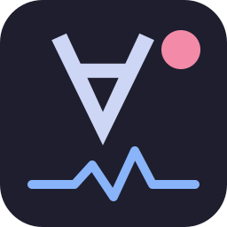
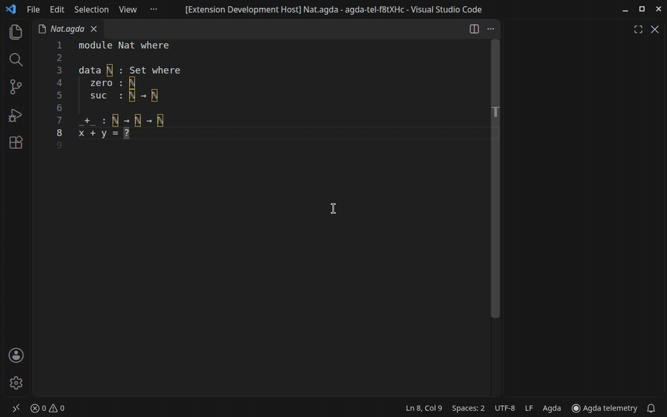
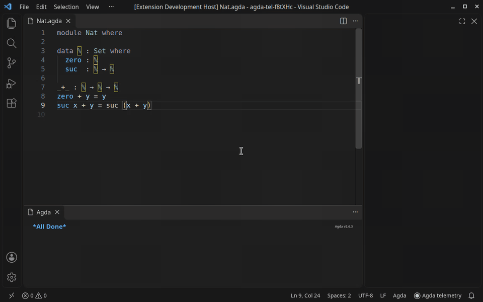
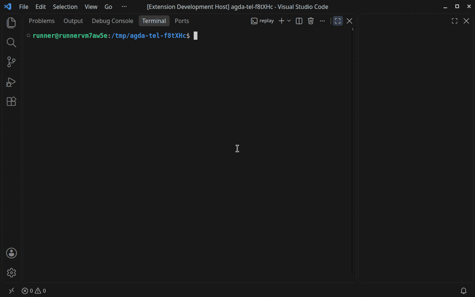

<p align="center"></p>
<h1 align="center">Agda Mode Telemetry</h1>

<p align="center">
  <a href="https://github.com/kiranandcode/agda-mode-telemetry-vscode/actions/workflows/ci.yml"></a>
  <a href="https://marketplace.visualstudio.com/items?itemName=kiranandcode.agda-mode-telemetry"></a>
  <a href="https://open-vsx.org/extension/kiranandcode/agda-mode-telemetry"></a>
</p>

Idea: record how Agda proofs actually get written.

Every command you run, every response Agda sends back, and the state of the buffer after each
step, saved to a SQLite database next to your Agda file as you work. The extension sits
alongside [agda-mode](https://marketplace.visualstudio.com/items?itemName=banacorn.agda-mode)
and writes the same format as its Emacs sibling,
[agda-mode-telemetry](https://github.com/kiranandcode/agda-mode-telemetry). Sessions from
either editor replay with the same tools.

## Quick start

1. Install [Agda](https://agda.readthedocs.io/en/latest/getting-started/installation.html) and this extension (agda-mode comes with it):
   ```sh
   code --install-extension kiranandcode.agda-mode-telemetry
   ```
2. Open an `.agda` file and load it with `C-c C-l`.

That's it. *Agda telemetry* in the status bar means the session is being recorded to
`.agda-telemetry.db` in the same directory.

## Features

- Records as you prove: `C-c C-l`, `C-c C-c`, `C-c C-SPC`, `C-c C-r`, …



- Share a session as Markdown. Click *Agda telemetry* in the status bar, then *Copy session trace*.



- Export everything as a zip. *Agda Telemetry: Export Telemetry…* bundles a consistent copy of
  every database in the workspace, ready to send to whoever is collecting them.

- Replay with the Emacs tools. `telemetry-replay.py` and `telemetry-extract.py` from
  [agda-mode-telemetry](https://github.com/kiranandcode/agda-mode-telemetry) read the
  databases as they are.



- Pause and resume from the same menu, or set `"agdaTelemetry.enabled": false`.

## What gets recorded

Three tables in `.agda-telemetry.db`. The full schema is in the
[Emacs README](https://github.com/kiranandcode/agda-mode-telemetry#database-schema).

| Table       | One row per                                  | Holds                                                                       |
|-------------|----------------------------------------------|-----------------------------------------------------------------------------|
| `events`    | command (`agda2-load`, `agda2-give`, …)      | session, timestamp, cursor position, goal number and contents, buffer diff |
| `snapshots` | session start/end and buffer-changing round  | the full text of the buffer                                                 |
| `responses` | Agda response (highlighting excluded)        | the Emacs handler it maps to and its arguments                              |

Snapshots are your code. Nothing leaves your machine unless you export or copy it.

## Installation

| Where                                                                                                              | How                                                         |
|:-------------------------------------------------------------------------------------------------------------------|:------------------------------------------------------------|
| [VS Code Marketplace](https://marketplace.visualstudio.com/items?itemName=kiranandcode.agda-mode-telemetry)        | search *Agda Mode Telemetry* in Extensions                  |
| [Open VSX](https://open-vsx.org/extension/kiranandcode/agda-mode-telemetry) (VSCodium, Cursor, …)                  | search *Agda Mode Telemetry* in Extensions                  |
| [GitHub releases](https://github.com/kiranandcode/agda-mode-telemetry-vscode/releases)                             | `code --install-extension agda-mode-telemetry-v0.1.0.vsix` |

Needs VS Code 1.101 or later, which ships the `node:sqlite` the extension writes with. There
are no native modules to build.

## Differences from Emacs

The extension listens on the log channel agda-mode exports (`exports.channels.log`) and does
what `agda2-telemetry.el` does with advice. Commands are logged under the name of the
`agda2-mode` command that does the same thing, and responses under the Emacs handler they come
from. Three things differ:

- `responses.args_text` is JSON, not an s-expression, since VS Code only sees responses after
  agda-mode has parsed them. For example, `agda2-give-action` is `[0,"GiveNoParen"]`.
- agda-mode reports a response once its handler has finished, so a response whose handler runs
  a command comes after that command's responses. After a case split, `agda2-make-case-action`
  follows the reload's responses. Emacs logs it first.
- `col` counts characters, where Emacs counts display width.

## Development

```sh
npm install
npm run build         # dist/extension.js
npm run test:unit     # mapping, formats, zip, traces
npm run test:e2e      # real VS Code + agda-mode + agda; needs agda on PATH
npm run package       # agda-mode-telemetry-<version>.vsix
```

To release, run `npm version patch && git push --follow-tags`. The
[release workflow](.github/workflows/release.yml) attaches the `.vsix` to a GitHub release
and publishes to the Marketplace and Open VSX. The GIFs above are recorded by the
[demo workflow](.github/workflows/demo.yml) under Xvfb with ffmpeg. Re-run it from the
Actions tab after changing the UI.

### Project structure

| File                 | Description                                                                  |
|----------------------|------------------------------------------------------------------------------|
| `src/extension.ts`   | Activation, the status bar item and the commands                             |
| `src/recorder.ts`    | Sessions and interaction rounds, the counterpart of `agda2-telemetry.el`     |
| `src/agda.ts`        | Decodes agda-mode's ReScript values and maps them to Emacs names             |
| `src/db.ts`          | The SQLite schema, identical to the Emacs one                                |
| `src/share.ts`       | Zip export and Markdown session traces                                       |
| `src/zip.ts`         | A small zip writer                                                           |
| `src/util.ts`        | Timestamps, session ids, diffs, finding `{! !}` goals                        |
| `test/e2e`           | Loads, case-splits and gives in a real VS Code, then checks the database     |
| `test/demo`          | The script behind the GIFs                                                   |
